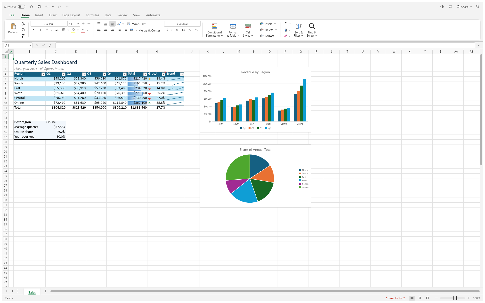
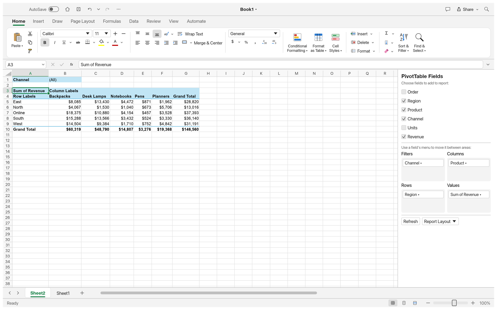
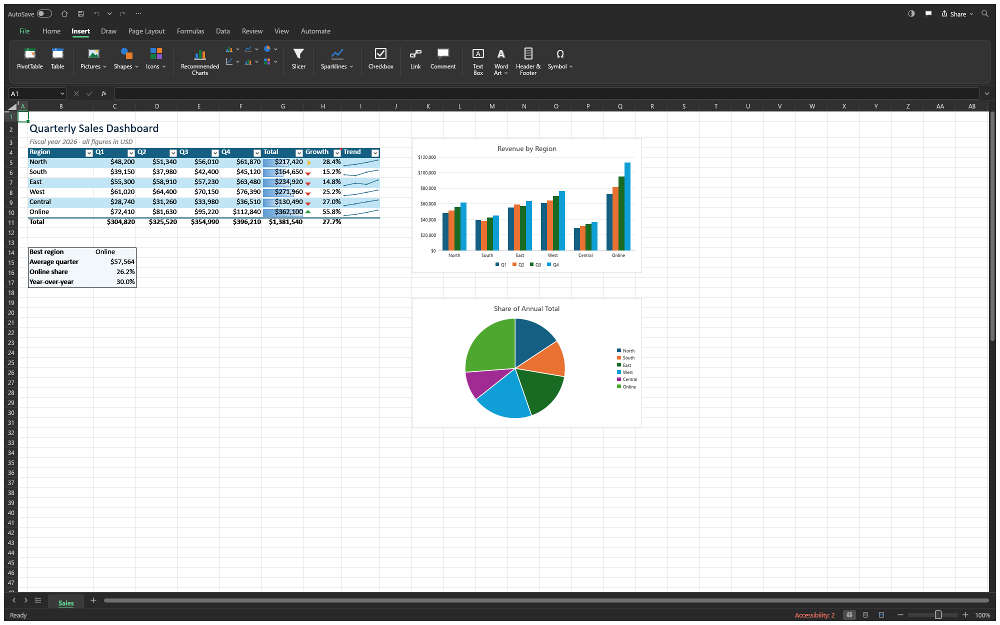

<p align="center">
  
</p>

<h1 align="center">Cella</h1>

<p align="center"><b>An independent, high-performance spreadsheet built in Rust.</b><br>
For data sets, for agents, and for the files people actually send — native on macOS, Windows, Linux
and BSD, and in the browser via WebAssembly.</p>

<p align="center">
  <b>English</b> · <a href="README.zh-CN.md">简体中文</a> ·
  <a href="#what-it-does">What it does</a> ·
  <a href="#look-around">Look around</a> ·
  <a href="#quick-start">Quick start</a> ·
  <a href="#docs">Docs</a> ·
  <a href="#licence-and-credits">Licence</a>
</p>

> **This is an independent, modified version of GridCraft**, based on the work of the ArtCraft team
> and the GridCraft contributors (MIT OR Apache-2.0 — see [`NOTICE`](NOTICE)). It is **not an
> ArtCraft product** and carries **none of the ArtCraft marks**: upstream's brand licence requires a
> modified version to remove them, and this tree did. The product name, the app identifiers and the
> icon are Cella's own — the decision and the list are in
> [`docs/roadmap.md`](docs/roadmap.md) § Product position.

## What it does

- **Files** — reads and writes `.xlsx` (styles, tables, charts, PivotTables, conditional formats,
  validation, comments, slicers and timelines, pass-through of unmodelled parts), reads `.xls`
  including its charts and shapes, reads and writes password-protected packages, CSV/TSV, our own
  JSON workbook, PDF export and printing.
- **Calculation** — 500+ Excel functions, dynamic arrays and spills, `LET`/`LAMBDA`, tables and
  structured references, iterative calculation, multi-threaded recalculation.
- **Data** — the query pipeline (a database file or a URL as a source), Parquet, the DAX data model,
  PivotTables and PivotCharts, slicers and timelines.
- **Agents** — every user-visible action is a command, and the MCP server, the CLI and the control
  channel reach the same set: [control protocol](docs/control-protocol.md), [CLI](docs/cli.md),
  [MCP](docs/mcp.md).
- **Interface** — en and zh-CN, key tips, keyboard context menus, an accessibility tree, and an
  offscreen snapshot for tests.

Performance is a feature, not an afterthought: the 1,000,000-row × 6-column reference workbook holds
**0.88 GB** of live heap, saves in ~2 s and opens in ~4 s on the development machine — against
**7.9 s** for Excel 16 to open the same file and **0.31 s** for it to run the same recalculation. The
numbers, the harness, the comparison and the gate are in [docs/performance.md](docs/performance.md).

## Look around


<sub><b>Quarterly sales dashboard.</b> A table with a totals row, conditional formatting, sparklines
and two live charts — the sample workbook (`File → New → Sample`), rendered offscreen by
`crates/ui-egui/examples/snapshot.rs`.</sub>

<table>
<tr>
<td width="50%" valign="top"><p><sub><b>PivotTables.</b> Field list, filters, layouts, date grouping and show-values-as, saved to and read from XLSX.</sub></p></td>
<td width="50%" valign="top"><p><sub><b>Dark mode</b> and the Insert tab: tables, charts, sparklines, pictures, shapes, links and comments.</sub></p></td>
</tr>
</table>

## Quick start

```bash
cargo run --release -p cella -- --sample sales                        # the desktop app
cargo run --release -p cella -- --sample sales --control 7979         # + control channel
cargo run -p cella-cli -- eval '=SUM(1,2,3)'                          # headless evaluation
cargo run -p cella-cli -- mcp                                        # the MCP server on stdio
cargo run -p cella-ui-egui --example snapshot -- --sample sales out.png   # offscreen render
```

## Docs

- [`docs/roadmap.md`](docs/roadmap.md) — product position, milestones, what is next
- [`ROADMAP.md`](ROADMAP.md) — the one-page summary and progress log
- [`docs/performance.md`](docs/performance.md) — the reference workbook, the scenarios, the gate
- [`docs/architecture.md`](docs/architecture.md) — layers, crates, invariants
- [`docs/gaps.md`](docs/gaps.md) — every known shortfall, ranked
- [`docs/target-app-parity.md`](docs/target-app-parity.md) — the assessment against Excel

## Licence and credits

MIT OR Apache-2.0, at your option ([`LICENSE-MIT`](LICENSE-MIT), [`LICENSE-APACHE`](LICENSE-APACHE)).
The original work is Copyright (c) 2026 the ArtCraft Team and the GridCraft contributors;
modifications in this repository are Copyright (c) 2026 its contributors. Asset attribution is in
[`ATTRIBUTION.md`](ATTRIBUTION.md); third-party material and the trademark position are in
[`NOTICE`](NOTICE).
