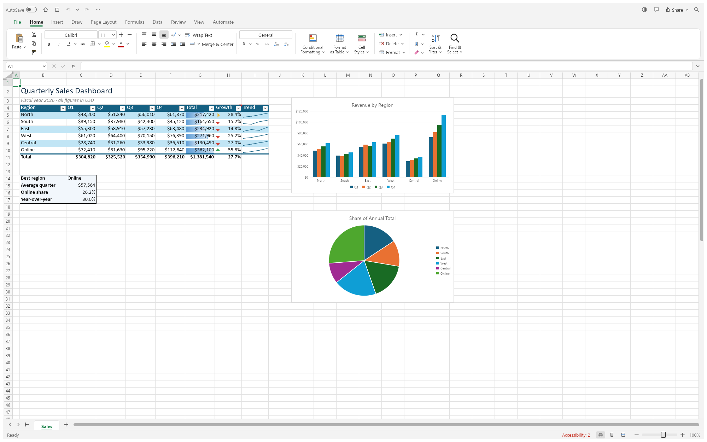
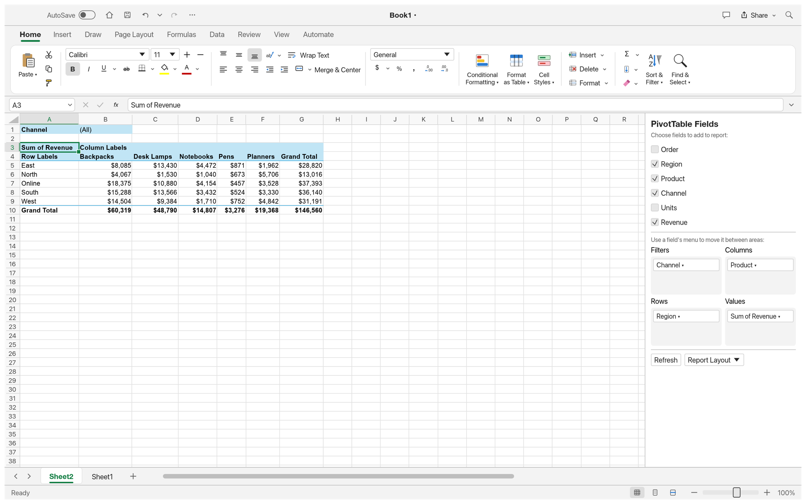
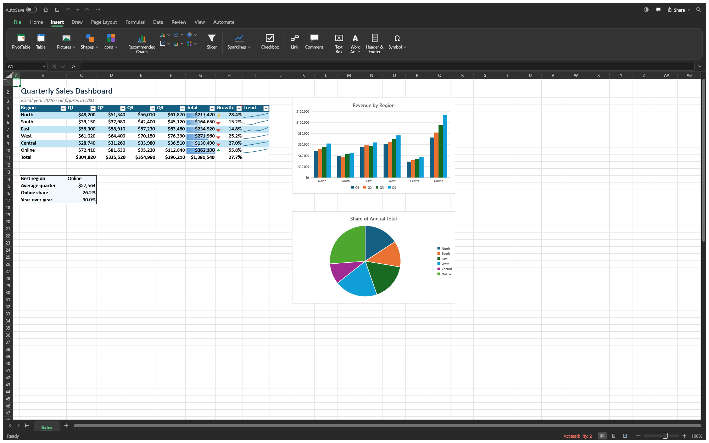

<p align="center">
  
</p>

<h1 align="center">Cella</h1>

<p align="center"><b>一个独立的、高性能的 Rust 电子表格。</b><br>
为数据集而生，为 agent 而生，也为别人真的会发给你的那些文件而生 —— 原生运行于 macOS、Windows、
Linux 与 BSD，也能通过 WebAssembly 跑在浏览器里。</p>

<p align="center">
  <a href="README.md">English</a> · <b>简体中文</b> ·
  <a href="#功能">功能</a> ·
  <a href="#看一眼">看一眼</a> ·
  <a href="#快速开始">快速开始</a> ·
  <a href="#文档">文档</a> ·
  <a href="#许可与致谢">许可与致谢</a>
</p>

> **本仓库是 GridCraft 的一个独立修改版**，基于 ArtCraft 团队与 GridCraft 贡献者的工作
> （MIT OR Apache-2.0，见 [`NOTICE`](NOTICE)）。它**不是 ArtCraft 产品**，也不包含任何 ArtCraft
> 标识：上游的品牌许可要求分发修改版时移除这些标识，本仓库已移除。产品名、应用标识与图标都是
> Cella 自己的——决定与清单见 [`docs/roadmap.md`](docs/roadmap.md) § Product position。

## 功能

- **文件** —— 读写 `.xlsx`（样式、表格、图表、数据透视表、条件格式、数据验证、批注、切片器与
  时间线、未建模内容原样透传），读取 `.xls` 及其图表与形状，读写带密码的包，CSV/TSV，自有 JSON
  工作簿，PDF 导出与打印。
- **计算** —— 500 多个 Excel 函数、动态数组与溢出、`LET`/`LAMBDA`、表格与结构化引用、迭代计算、
  多线程重算。
- **数据** —— 查询管道（数据库文件或 URL 作为数据源）、Parquet、DAX 数据模型、数据透视表与
  数据透视图、切片器与时间线。
- **Agent** —— 每一个用户可见动作都是一个命令，MCP 服务、CLI 与控制通道访问的是同一套命令：
  [控制协议](docs/control-protocol.md)、[CLI](docs/cli.md)、[MCP](docs/mcp.md)。
- **界面** —— 中英双语、键位提示、键盘上下文菜单、无障碍树，以及用于测试的离屏截图。

性能是功能，不是补丁：100 万行 × 6 列的参考工作簿占用 **1.14 GB** 活堆内存，在开发机上保存约
2 秒、打开约 4 秒。数字、测量工具与门禁见 [docs/performance.md](docs/performance.md)。

## 看一眼


<sub><b>季度销售看板。</b>一张带汇总行、条件格式、迷你图和两个实时图表的表格——示例工作簿
（`File → New → Sample`），由 `crates/ui-egui/examples/snapshot.rs` 离屏渲染。</sub>

<table>
<tr>
<td width="50%" valign="top"><p><sub><b>数据透视表。</b>字段列表、筛选、布局、日期分组与"显示值方式"，可存取 XLSX。</sub></p></td>
<td width="50%" valign="top"><p><sub><b>深色模式</b>与"插入"选项卡：表格、图表、迷你图、图片、形状、链接与批注。</sub></p></td>
</tr>
</table>

## 快速开始

```bash
cargo run --release -p cella -- --sample sales                        # 桌面应用
cargo run --release -p cella -- --sample sales --control 7979         # 同时打开控制通道
cargo run -p cella-cli -- eval '=SUM(1,2,3)'                          # 无界面求值
cargo run -p cella-cli -- mcp                                        # 在 stdio 上起 MCP 服务
cargo run -p cella-ui-egui --example snapshot -- --sample sales out.png   # 离屏渲染一张图
```

## 文档

- [`docs/roadmap.md`](docs/roadmap.md) —— 产品定位、里程碑、下一步
- [`ROADMAP.md`](ROADMAP.md) —— 一页纸摘要与进度日志
- [`docs/performance.md`](docs/performance.md) —— 参考工作簿、测量场景与性能门禁
- [`docs/architecture.md`](docs/architecture.md) —— 分层、crate 划分与不变量
- [`docs/gaps.md`](docs/gaps.md) —— 已知差距，按影响排序
- [`docs/target-app-parity.md`](docs/target-app-parity.md) —— 对标 Excel 的评估

## 许可与致谢

MIT OR Apache-2.0，二选一（[`LICENSE-MIT`](LICENSE-MIT)、[`LICENSE-APACHE`](LICENSE-APACHE)）。
原始工作的版权归 (c) 2026 ArtCraft Team 与 GridCraft 贡献者；本仓库的修改版权归 (c) 2026 本仓库
贡献者。资产归属见 [`ATTRIBUTION.md`](ATTRIBUTION.md)；第三方材料与商标立场见
[`NOTICE`](NOTICE)。
